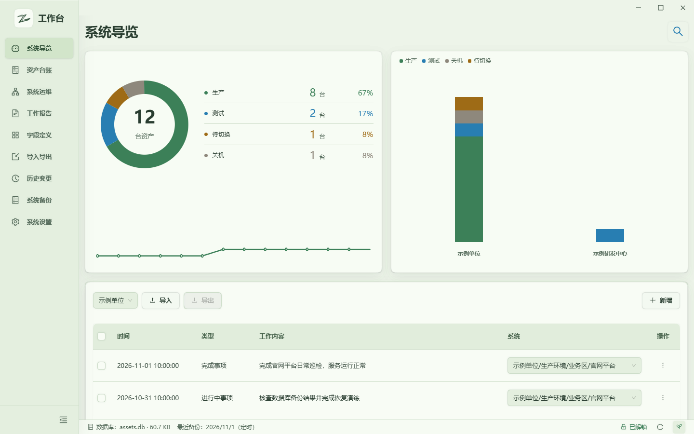
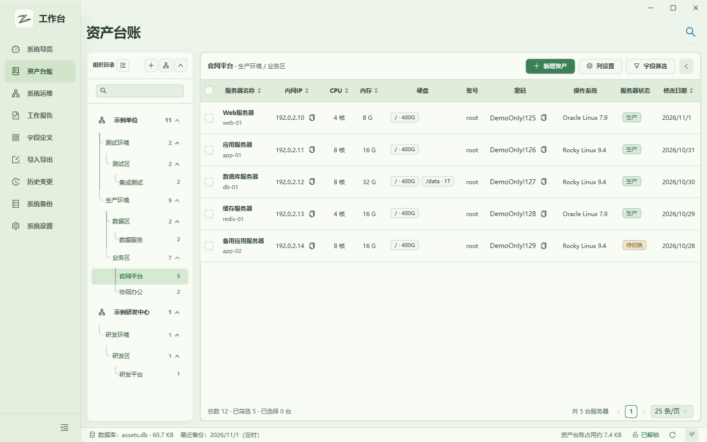
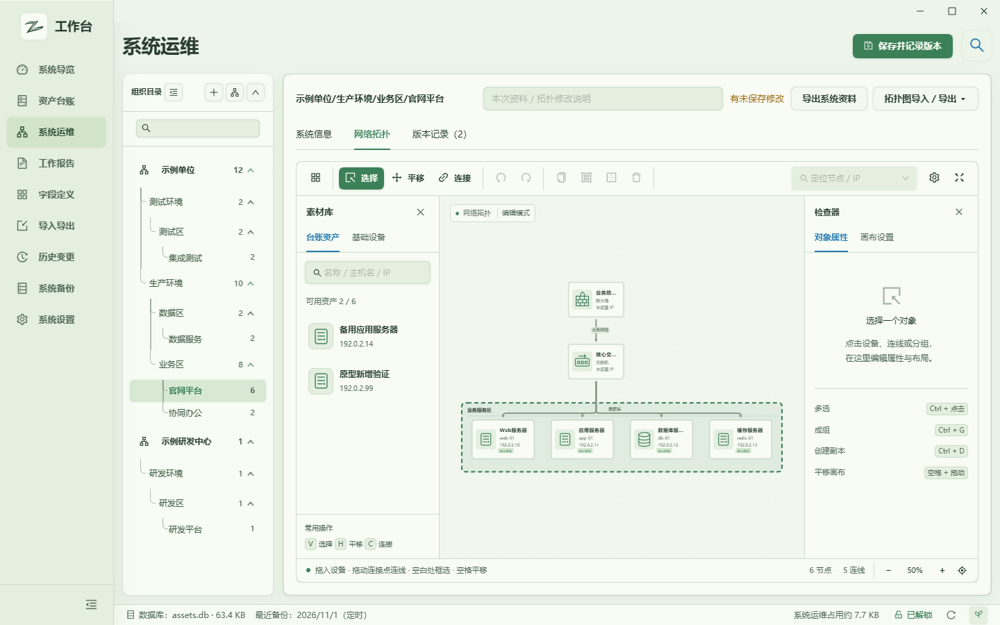
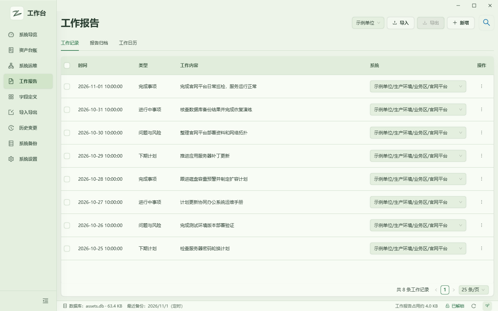

# 工作台 · HTML 原型 (Workbench HTML Prototype)

一个可离线打开、可直接编辑的桌面「工作台」界面 HTML 原型。它把完整的 React + Ant Design + AntV X6 + Tiptap 前端打包成单个 HTML 文件，内置脚本、样式、图标与 Worker，**无需后端、不访问网络**，默认载入全虚构演示数据，适合用来查看界面布局、交互流程，或作为跨端重写时的设计基准。

> 全部数据均为虚构演示数据，IP 使用文档示例网段（RFC 5737）。原型**不是**正式桌面应用，也不提供真实加密保险库。

## 预览

| 系统导览 | 资产台账 |
| --- | --- |
|  |  |

| 系统运维 · 拓扑 | 工作报告 |
| --- | --- |
|  |  |

其余页面（工作日历、字段定义、导入导出、历史变更、系统备份、系统设置、窄/宽窗口、解锁与初始化界面）截图见 [`docs/预览/`](docs/预览/)。

## 快速开始

### 方式一：直接打开

双击 [`工作台-v1.2.5-HTML原型.html`](工作台-v1.2.5-HTML原型.html)，使用桌面版 Chrome 或 Edge 即可离线运行，默认自动进入系统导览。

- 解锁界面：地址末尾加 `?gate=unlock`
- 初始化界面：地址末尾加 `?gate=setup`（使用独立演示存储）
- 恢复样例：地址末尾加 `?reset=1`
- 全局搜索：点击右上角搜索按钮或按 `F4`

演示主密码、各入口与操作说明见 [`使用说明.html`](使用说明.html)。

### 方式二：开发与重新构建

```powershell
npm install
npm run dev      # 本地开发预览
npm run build    # 重新生成单 HTML 到 dist/
npm run check    # TypeScript 类型检查
```

构建产物为 `dist/工作台-v1.2.5-HTML原型.html`。首次安装依赖需要联网，仓库不包含 `node_modules`。

## 目录结构

```text
├── 工作台-v1.2.5-HTML原型.html   预构建的离线单文件原型
├── 使用说明.html                  原型各入口与操作说明
├── index.html                     开发入口
├── src/                           React 源码（页面、组件、样式、主题）
├── prototype/                     浏览器适配层：数据存储、备份、Excel、桌面命令替身
├── src-tauri/icons/               界面使用的图标资源
├── docs/
│   ├── 设计规格/                  12 份界面设计规格（可作跨端重写基准）
│   └── 预览/                      18 张界面截图
├── package.json
├── tsconfig.json
└── vite.config.ts
```

`prototype/` 中的 `core.ts` / `event.ts` / `window.ts` 是桌面框架接口（`@tauri-apps/api/*`）在浏览器里的替身，源码通过 `tsconfig` 的路径别名指向它们，因此无需改动 `src/` 即可在浏览器运行。

## 覆盖页面

| 页面 | 可操作内容 |
| --- | --- |
| 系统导览 | 资产统计、状态分布、单位统计、近期变更、密码维护、备份状态、跳转 |
| 资产台账 | 四级组织目录、新增/编辑/删除、筛选、排序、详情、账号切换、复制、列设置、左侧冻结 |
| 系统运维 | 组织目录、Markdown 编辑/源码、资产绑定、X6 拓扑拖动/连接/分组/缩放/撤销、版本保存/预览/回滚、拓扑导入导出 |
| 工作报告 | 工作记录、日历、提醒、日报/周报/月报/年报编辑和归档、记录/日历导入导出 |
| 字段定义 | 系统字段、自定义字段、字段排序、模板配置与导入导出 |
| 导入导出 | .xlsx 预检、列映射、冲突处理、导入、导出、密码确认、结果报告 |
| 历史变更 | 搜索筛选、差异详情、回滚、审计导出、原型专用 ZIP 归档 |
| 系统备份 | 演示备份创建/列表/删除/恢复、保留策略、恢复确认 |
| 系统设置 | 设置分组、主题、自动锁定、密码修改、重新初始化、快捷键、备份设置、技术栈 |

进入台账或系统运维后，展开组织目录并选择「官网平台」即可看到完整示例。组织和全部样例都可编辑；刷新后保留已保存修改。

## 原型与桌面应用的边界

- 数据全部虚构。原型不读取真实 SQLite、备份、注册表或用户文件，不连接业务接口。
- 演示数据和备份存在浏览器 LocalStorage；**没有桌面保险库的加密保护，不要录入真实账号、密码或业务数据**。清除浏览器存储会丢失修改。
- 自启动、关闭行为、托盘、全局快捷键注册和备份目录仅保存演示状态，不会操作 Windows；F4 仅在原型标签页内生效。
- 文件导出使用浏览器下载；Excel 适配器支持基础 .xlsx 单元格和列映射，不执行公式，不支持旧版 .xls、宏或复杂工作簿。
- 演示历史 ZIP 与演示备份均为浏览器端格式，与正式桌面应用格式不互通。
- 外部节假日接口在离线原型中不请求；系统通知在页面中演示。

可在浏览器控制台执行 `assetopsPrototype.exportData()` 下载原型 JSON，或 `assetopsPrototype.reset()` 恢复样例；这两个接口只影响本原型。

## 设计规格

[`docs/设计规格/`](docs/设计规格/) 提供 12 份界面规格（总览、应用外壳、各页面、解锁与响应式），包含颜色令牌、字体、间距、圆角与组件规范，可作为将界面重写为其他框架时的参考。基线主题为 spring（早春）。

## 许可证

本项目基于 [MIT License](LICENSE) 开源。
